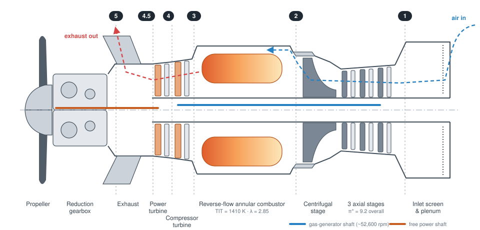
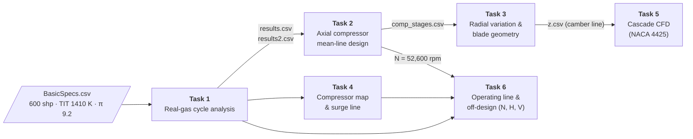
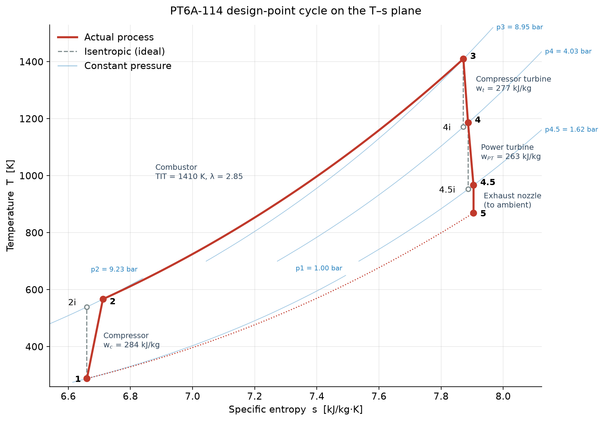

<div align="center">

# PT6A-114 Turboprop — Real Engine Cycle & Component Design

**A complete preliminary design of the Pratt & Whitney Canada PT6A-114, from real-gas cycle analysis to compressor blading, cascade CFD and off-design performance.**

[](https://www.python.org/)
[](LICENSE)
[](#acknowledgements)
[](#reports)



<sub>Schematic of the reverse-flow PT6A-114 (Cessna 208 Caravan) with the station numbering used throughout the code.</sub>

</div>

---

## Overview

The PT6A-114 is a free-turbine turboprop: a 3-stage axial + 1 centrifugal compressor driven by a single-stage compressor turbine, and a separate power turbine driving the propeller through a reduction gearbox. Air enters at the rear and flows forward, so the exhaust leaves just behind the propeller.

This repository designs that engine in six connected steps, written for **AERO 417 — Aerospace Propulsion**. Each task reads the previous task's results, so the cycle numbers flow all the way through to the compressor blades and the performance maps.



## Design point at a glance

| | Parameter | Value |
|---|---|---|
| **Inputs** | Shaft power | 600 hp (441.6 kW) |
| | Turbine inlet temperature | 1410 K |
| | Compressor pressure ratio | 9.2 |
| | Component efficiencies (η<sub>c</sub> / η<sub>t</sub> / η<sub>PT</sub>) | 0.90 / 0.94 / 0.94 |
| **Cycle results** | Air mass flow | 1.641 kg/s |
| | Fuel flow | 0.0392 kg/s (141 kg/h) |
| | Excess-air ratio λ | 2.85 |
| | Compressor work | 284 kJ/kg |
| | Residual jet thrust | 786 N |
| | Equivalent BSFC | 0.333 kg/kWh |
| **Compressor** | Gas-generator speed | ≈ 52,600 rpm |
| | Axial inlet tip diameter, hub/tip ratio | 127 mm, 0.50 |

The cycle uses real-gas properties for air and for combustion products, treating the burned gas as a mix of stoichiometric products and excess air rather than assuming constant c<sub>p</sub>.

<div align="center">

</div>

## Results gallery

<table>
  <tr>
    <td width="50%" align="center">
      <br>
      <sub><b>Compressor map</b> with speed lines, surge line and the computed operating line (Tasks 4 & 6)</sub>
    </td>
    <td width="50%" align="center">
      <br>
      <sub><b>Cascade CFD</b>: surface Mach number on the cambered NACA 4425 blade at M = 0.46 (Task 5)</sub>
    </td>
  </tr>
  <tr>
    <td width="50%" align="center">
      <br>
      <sub><b>Thrust</b> vs flight speed from sea level to 10 km (Task 6)</sub>
    </td>
    <td width="50%" align="center">
      <br>
      <sub><b>Specific fuel consumption</b> vs flight speed and altitude (Task 6)</sub>
    </td>
  </tr>
</table>

## The six tasks

| Task | What it does | Main files |
|---|---|---|
| [**1 · Cycle analysis**](task1/) | Station-by-station real cycle (a → 1 → 2 → 3 → 4 → 4.5 → 5) using air and combustion-product gas tables; solves for λ, mass flows, works, residual thrust and EBSFC. | `main.py`, `stages.py`, `Iterations.py`, `ts_diagram.py` |
| [**2 · Axial compressor**](task2/) | Splits the work between the axial and centrifugal sections, sizes the inlet annulus and solves each stage's degree of reaction. | `task2_main.py`, `Iter.py` |
| [**3 · Radial variation**](task3/) | Free-vortex velocity triangles from hub to tip and blade geometry (pitch-to-chord, incidence, deviation, camber line). | `task3_main.py`, `Steps.py` |
| [**4 · Compressor map**](task4/) | Scales a generalised axial-compressor map to the design point and draws speed lines, efficiency and the surge line. | `task4_main.py`, `steps.py` |
| [**5 · Cascade CFD**](task5/) | Builds the blade from the Task 3 camber line and runs a 2-D cascade solver on the course cluster. | `airfoil.py`, `task5main.py`, `i.n0006` |
| [**6 · Off-design**](task6/) | 12-step operating-line calculation, then performance versus wheel speed and versus altitude and flight speed. | `task6main.py`, `Steps.py`, `OL_repeater.py`, `AltSpeedVariation.py` |

Each folder has its own README with the equations and output-file formats.

## Quick start

```bash
git clone https://github.com/Carmeisel101/RealEngineCycle_TurboProp.git
cd RealEngineCycle_TurboProp
make setup     # creates .venv and installs requirements.txt
make           # runs tasks 2-6 and redraws the T-s diagram
```

| Command | What it runs |
|---|---|
| `make` | Tasks 2 → 3 → 5 and 2 → 6 → 4, plus the T-s diagram, starting from the committed Task 1 results |
| `make full` | Re-runs the Task 1 cycle analysis first, then everything above |
| `make task4` | A single task, plus the tasks it depends on |
| `make task6 SHOW=1` | Opens the plot windows instead of rendering headless |
| `make help` | Lists the targets |

Without `make`, install with `pip install -r requirements.txt` and run each script from inside its task folder (paths are relative), for example `cd task1 && python ts_diagram.py`.

> [!NOTE]
> Task 1 calls a course-provided Fortran gas-properties program, embedded as a Windows build (`winGasProp.py`) and a macOS x86-64 build (`macGasProp.py`); `task1/gasprop.py` picks the right one. The macOS build needs gfortran's runtime library from an Intel Homebrew `gcc` install, so `make full` may not run on every machine; the rest of the pipeline uses only Python. Task 5's CFD solver runs on the Texas A&M `jp1` cluster; see [task5/README.md](task5/README.md).

## Reports

- [Task 4 — Compressor map](task4/Report/task4_report.pdf)
- [Task 5 — Cascade CFD](task5/report/task5.pdf)
- [Task 6 — Operating line and off-design performance](task6/report/task6report.pdf)

## Repository layout

```text
RealEngineCycle_TurboProp/
├── docs/            # README graphics
├── task1/           # cycle analysis, gas tables, T-s diagram
├── task2/           # axial compressor mean-line design
├── task3/           # radial variation and blade geometry
├── task4/           # compressor map  (+ Report/)
├── task5/           # cascade CFD     (+ report/)
└── task6/           # operating line and off-design (+ report/, resultTables/)
```

## Acknowledgements

Developed for AERO 417 (Aerospace Propulsion) at Texas A&M University. The method follows Dr. Cizmas's course notes and textbook; the gas-properties program and the cascade CFD solver were provided by the course.

## License

[MIT](LICENSE) © 2022 Carlos Meisel
